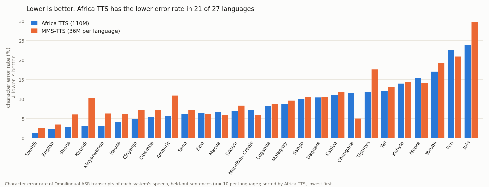

# Benchmarks

## Speed

Measured with [`benchmarks/speed.py`](../benchmarks/speed.py) on a dedicated 4-vCPU Modal CPU
container ([`benchmarks/speed_modal.py`](../benchmarks/speed_modal.py)): 8 sentences in Twi, Hausa,
Yoruba, Swahili, Zulu, Amharic, Ewe and English, each language's default voice, after a warm-up
(voice prompts encoded once and cached). PyTorch runs on one thread (pocket-tts's default);
sherpa-onnx uses int8 models on four threads.

| Runtime | × real time | Real-time factor | Time to first audio (streaming, median) |
|---|---:|---:|---:|
| sherpa-onnx int8 (mobile) | **2.52** | 0.40 | — |
| PyTorch (CPU) | **2.38** | 0.42 | **0.17 s** |

PyTorch runs at 2.4× real time on a 4-vCPU cloud machine and about 2× on a laptop CPU, streaming its
first audio after 0.17 s without quantization loss.

For comparison, the 24-layer base model Africa TTS was distilled from runs at 0.47× real time
guided (0.72 s to first audio) and 0.82-0.90× unguided.

"× real time" is seconds of audio per second of compute: above 1, audio is generated faster than
it plays. Raw results: [benchmarks/results/speed_modal_4vcpu.json](../benchmarks/results/speed_modal_4vcpu.json).
On the API server, each worker runs one request at a time, so throughput scales with
workers × cores ([server/](../server/README.md#scaling)).

Run it on your machine:

```bash
pip install africa-tts sherpa-onnx   # from a clone of this repository
python benchmarks/speed.py --threads 4
```

## Intelligibility

How well can the speech be understood? Each system reads the same held-out sentences, and
[Omnilingual ASR](https://huggingface.co/facebook/omniASR-LLM-7B) (`omniASR_LLM_7B_v2`)
transcribes the audio. We report the **character error rate (CER, %, lower is better)** after
NFC normalisation, lower-casing and punctuation removal.



- Against MMS-TTS, Africa TTS wins 21 of 27 languages (average CER 9.0% vs 10.3%).
- OmniVoice wins 24 of 29, by small margins (8.4% vs 8.8% on average), at about 7× Africa TTS's
  size.
- On the 24 languages with human recordings, Africa TTS (7.7%) is within 0.2 points of the
  ASR's error on the real speech (7.5%).
- Distillation costs nothing: over all 45 languages Africa TTS averages 9.1%, the same as the
  guided 24-layer base model it was distilled from (unguided: 10.8%).
- With diacritics removed before scoring, all CERs drop but the ranking is the same.

Per-language results (including the base model) and the diacritic-free table:
[benchmarks/results/intelligibility.md](../benchmarks/results/intelligibility.md)
(raw: [intelligibility.json](../benchmarks/results/intelligibility.json)).

**Setup.**
- **Test sentences:** up to 50 per language for 47 trained languages (2,154 sentences). They
  come from the Omnilingual ASR corpus (test split, else dev, else train; five languages with
  tiny splits are topped up from the next split), FLEURS test, WAXAL test, or FLORES+ devtest (text only), in that order of preference.
  Sentences with digits, under 20 or over 220 characters are dropped. None are in our training
  data.
- **Voices:** Africa TTS (and its base model) uses each language's default voice at temperature 0.3. OmniVoice clones
  the same voice clip, with the clip's transcript taken from Omnilingual ASR where no full human
  transcript exists. MMS-TTS (uroman for non-Latin scripts) uses its own voices.
- **Averages:** languages with fewer than 10 sentences are left out of the means.
- **Parameter counts** are measured on the released checkpoints, codec or vocoder included.

**Caveats.**
- The metric measures intelligibility only, not naturalness or speaker similarity, and it
  inherits the ASR's own errors.
- Some Omnilingual ASR corpus sentences come from its train split, which the ASR may have seen.
  This favours all systems equally.
- FLEURS sentences are FLORES sentences read aloud.
- Chitumbuka, Swati and Kimbundu have no ASR language code and are transcribed without one.
- Synthetic speech can score below real speech: many recordings are noisy or spontaneous.

**Reproduce** (GPU; scripts in [benchmarks/](../benchmarks/)):

```bash
python benchmarks/build_testset.py BENCH                      # sentences + real recordings
python benchmarks/synth_africa_tts.py BENCH --system turbo    # Africa TTS (guided, unguided: base)
python benchmarks/synth_baselines.py BENCH VOICES --system mms   # also omnivoice
python benchmarks/transcribe.py BENCH                          # Omnilingual ASR
python benchmarks/score.py BENCH --min-n 10                    # results.json / results.md
```
